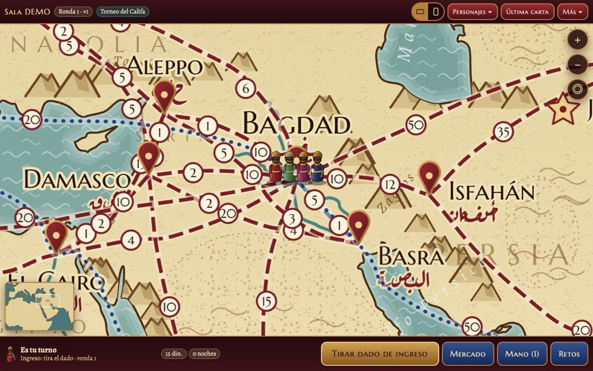
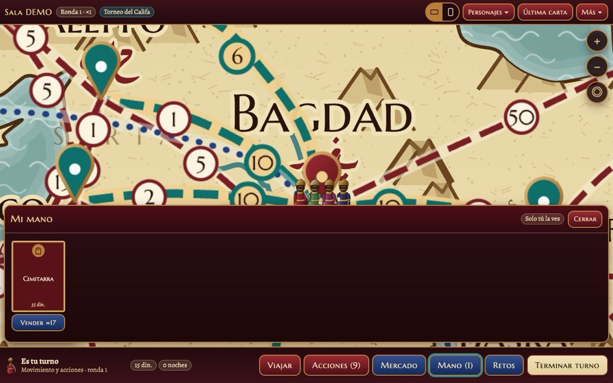
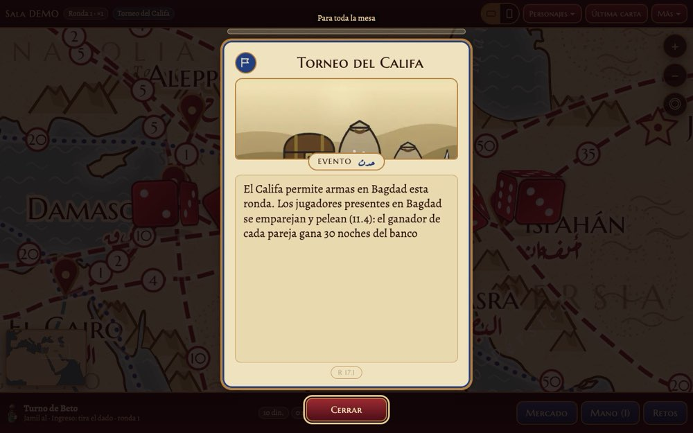
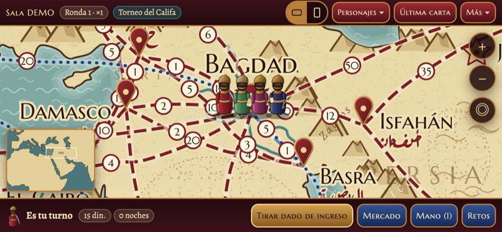
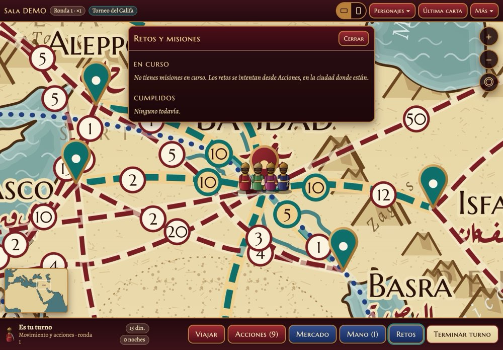

<h1 align="center">🌙 Mil y una Noches</h1>

<p align="center">
  <b>El juego de mesa, ahora en el navegador.</b><br>
  De 2 a 8 jugadores (o solitario contra Yafar), cada quien desde su teléfono, tablet o PC.<br>
  Sin instalar apps, sin cuentas: abre un enlace, escribe tu nombre y elige personaje.
</p>

<p align="center">
  
</p>

---

## ✨ Qué es

**Mil y una Noches** es un juego de viajes, comercio, intriga y cuentos por las ciudades del mundo clásico islámico. Gana el primero en reunir **1,001 noches**.

Esta versión web es el **juego completo** del reglamento extendido, jugable de principio a fin:

- 🗺️ **Tablero vectorial** con arrastre, zoom (pellizco o rueda), minimapa y «centrar en mi personaje». Se ve nítido en cualquier pantalla.
- 🎲 **Dados sincronizados**: todos ven la misma tirada al mismo tiempo.
- 🃏 **Mano privada**: cada jugador ve solo sus cartas, objetos y mensajes. El servidor nunca envía a nadie lo que no le toca.
- 🐪 Viajes y tarifas, hospedaje, mercado, tratos y trueque, combate y duelos, robos, los Asesinos, retos y misiones, tesoros y el Jorasán, eventos históricos, mensajes de los sheijs, trivias y cuentos de ambiente.
- 🤖 **Yafar el Bermekí** como NPC (fácil, normal o difícil) o como jugador. **Modo solitario** incluido.
- 🏦 **Panel del banco** para corregir errores: dar o quitar dinares y noches, repartir o barajar cartas, pasar turno…
- 💾 **Guardado automático**: si se cae la conexión o el servidor, la partida sigue donde iba.
- 📱 **En el teléfono, todo en vertical** y el mapa siempre apaisado, con zoom y arrastre. En PC, pantalla completa horizontal.

<p align="center">
  
  <br>
  
  
</p>

---

## 🚀 Jugar en casa (misma red Wi-Fi)

Necesitas [Node.js](https://nodejs.org) 18 o superior (`node --version`). Internet solo hace falta para instalar.

```bash
npm install      # una sola vez
npm run build    # compila el juego (repetir solo si cambia el código)
npm start        # arranca el servidor (Ctrl+C lo detiene)
```

La consola muestra la dirección, el **PIN del banco** y un código QR:

```
http://192.168.1.11:8080   (Wi-Fi)
PIN de anfitrión (para recuperar el rol de banco desde otro dispositivo): 1234
```

1. Cada jugador abre esa dirección en el navegador (o escanea el QR) **en la misma Wi-Fi**.
2. Escribe su nombre y elige personaje.
3. El primero en entrar es el **banco** y pulsa «Comenzar partida» cuando todos están listos.

> 💡 **Windows:** si los teléfonos no cargan la página, marca tu Wi-Fi como **red privada** y permite Node.js en el firewall para redes privadas.
> Las redes de invitados con «aislamiento de clientes» tampoco funcionan.

> 💡 **Arranque con doble clic:** crea `jugar.bat` con `cd /d %~dp0` y `npm start` en dos líneas.

---

## 🌍 Jugar por internet (con amigos fuera de tu casa)

El juego necesita un **servidor Node que siga encendido** y mantenga abiertas las conexiones WebSocket. Por eso **Netlify no sirve**: solo aloja páginas estáticas y funciones de corta duración. Lo más sencillo es [Render](https://render.com), que aloja todo junto (página y servidor) y tiene plan gratuito.

1. Sube esta carpeta a un repositorio de GitHub (ver [Qué subir](#-qué-subir-a-github)).
2. En Render: **New → Blueprint** y elige el repositorio. El archivo [`render.yaml`](render.yaml) ya trae la configuración.
   Render te pedirá el valor de **`MUN_CLAVE`**: escribe la clave de entrada de la partida (ver abajo).
   - Si prefieres hacerlo a mano: **New → Web Service**, runtime Node, build `npm install && npm run build`, start `node server/index.js --sin-qr`, y en **Environment** añade `MUN_CLAVE`.
3. Al terminar, Render te da una dirección como `https://mil-y-una-noches.onrender.com`. Compártela con los jugadores **junto con la clave**.
4. El **PIN del banco** en línea es la misma clave de entrada (`MUN_CLAVE`). En casa (sin `MUN_CLAVE`) el PIN es **1234**.

### 🌐 Dominio propio y demo

- **`https://milyunanoches.net/`** → el juego (sala, partida).
- **`https://milyunanoches.net/demo/`** → la muestra de un solo archivo, para que cualquiera vea cómo es el juego sin entrar a una partida. Es **pública**: no pide la clave. Su origen está en [`public/demo/index.html`](public/demo/index.html) (con su `vista-previa.jpg` para compartir en WhatsApp y redes); Vite la copia a `dist/demo/`.

Para conectar el dominio en Render:

1. En el servicio: **Settings → Custom Domains → Add Custom Domain**. Añade `milyunanoches.net` y también `www.milyunanoches.net`.
2. Render te muestra los registros DNS que debes crear donde compraste el dominio (normalmente un registro **A** o **ALIAS/ANAME** para `milyunanoches.net` y un **CNAME** para `www` que apunta a `mil-y-una-noches.onrender.com`). Copia exactamente lo que indique Render.
3. Espera a que Render marque el dominio como **Verified**. El certificado **HTTPS** se emite solo, en minutos u horas según el DNS.

### 🔑 Clave de entrada (`MUN_CLAVE`)

Como la dirección es pública, la partida en internet se protege con una clave:

- Si el servidor tiene la variable de entorno `MUN_CLAVE`, la pantalla de entrada muestra el campo **«Clave de la partida»** y nadie entra sin ella.
- Quien ya entró vuelve solo (con el token guardado en su navegador) sin volver a escribirla.
- Tras 10 claves incorrectas en un minuto desde la misma IP, el servidor deja de aceptar intentos durante un minuto. La clave nunca se imprime en los logs.
- Para cambiarla: en Render, **Environment → MUN_CLAVE → Save changes** (el servicio se reinicia).
- **En casa no se usa:** con `npm start` normal no hay `MUN_CLAVE` y no se pide clave. Si alguna vez la quieres en local: `MUN_CLAVE=miclave npm start` (en PowerShell: `$env:MUN_CLAVE="miclave"; npm start`).

**Ojo con el plan gratuito de Render:**
- Tras 15 minutos sin nadie conectado, el servidor se duerme. La primera visita tarda unos 30–60 s en despertarlo.
- El disco **no es permanente**: al dormirse o al volver a desplegar, **la partida guardada se pierde**. Para partidas de una sola sesión no pasa nada. Si quieres partidas de varios días, usa un plan con disco persistente (Render Starter + Disk, Railway o Fly.io con volumen) y apunta la variable `MUN_DATOS` a ese disco, por ejemplo `/var/data`.
- Cualquiera con el enlace puede entrar mientras la partida está en la sala de espera. Una vez empezada, nadie desconocido puede unirse.

---

## 📦 Qué subir a GitHub

Crea el repositorio **desde esta carpeta (`onlineGame`)**, de modo que `package.json` quede en la raíz. El `.gitignore` ya deja fuera lo que no debe subirse:

| Se sube ✅ | No se sube ❌ (se genera solo) |
|---|---|
| `server/`, `shared/`, `src/`, `public/` | `node_modules/` (lo crea `npm install`) |
| `package.json`, `package-lock.json`, `vite.config.js`, `index.html` | `dist/` (lo crea `npm run build`) |
| `render.yaml`, `README.md`, `plan-juego-web.md` | `datos/` (**partida guardada y tokens**: nunca la subas) |
| `tests/`, `tools/`, `docs/`, `ejemplos/`, `fallback/` | `paquete-servidor/` |

```bash
cd onlineGame
git init
git add .
git commit -m "Mil y una Noches: juego en línea"
git branch -M main
git remote add origin https://github.com/TU_USUARIO/mil-y-una-noches.git
git push -u origin main
```

> El reglamento y los PDF del juego de mesa viven fuera de esta carpeta y **no** se suben.

---

## 💾 Guardado y recuperación

La partida se guarda sola en `datos/partida.json` (dentro de esta carpeta), con copias `.bak1`, `.bak2` y `.bak3`. Al empezar una partida nueva, la anterior queda como `partida-anterior-<fecha>.json`. Para guardar en otra carpeta: `npm start -- --datos D:\mis-partidas` o la variable `MUN_DATOS`.

| Situación | Qué hacer |
|---|---|
| Un teléfono se apaga o recarga | Nada: vuelve solo a su sitio. |
| Se apaga el servidor o se va la luz | `npm start` otra vez y la partida continúa. |
| Un jugador cambia de navegador | Entra con el **mismo nombre** y recupera su sitio. |
| El banco pierde su dispositivo | Desde otro: menú **Más → Banco / anfitrión**, escribe el PIN y pulsa «Ser el banco». |
| Empezar de cero | `npm start -- --nuevo` (la anterior queda como `partida-anterior-<fecha>.json`) |
| Restaurar una copia | `npm start -- --restaurar ./datos/partida.json.bak1` |

**Opciones del servidor:** `--puerto 8080 --datos ./datos --nuevo --sin-qr --rapido --restaurar <archivo>`.
**Variables de entorno:** `PORT`, `MUN_DATOS` (carpeta de datos) y `MUN_CLAVE` (clave de entrada en línea).

---

## ⚙️ Ajustes de la versión en línea

En [`src/data/config.json`](src/data/config.json):

| Clave | Valor | Qué hace |
|---|---|---|
| `cartasDeMesa` | `false` | Sin cartas «de mesa» (preguntas sobre lo que pasó entre jugadores). Solo salen trivias. |
| `sinRobarPrimerasRondas` | `true` | Nadie puede **robar** en las 2 primeras rondas. Matar tampoco, como dice el reglamento. Los duelos sí se permiten. |
| `primerosTurnosSinMatar` | `2` | Número de rondas iniciales protegidas. |

El servidor usa **azar criptográfico** para dados y barajados, así que cada partida es distinta. La demo y las pruebas usan una semilla fija para poder repetirlas.

Las reglas no se cambian desde el código: la fuente es el reglamento extendido. Las reglas de la casa están en `reglasCasa` y se explican en `plan-juego-web.md`, sección 8.

---

## 🧪 Demo y pruebas

```bash
npm run dev       # y abre http://localhost:5173/?demo=1  (un solo dispositivo con bots)
npm test          # motor, cuentos, mensajes, 48 partidas simuladas y servidor real
npm run simular   # partidas completas por WebSocket con varios clientes
node tests/sim.mjs 6000   # 6000 partidas aleatorias sin errores ni bloqueos
```

Parámetros de la demo: `?demo=lobby`, `&bots=0`, `&pj=4`, `&semilla=7`, `?galeria=evento|historico|mensaje|objeto|trivia|cuento|personaje`.

> ⚠️ `npm run build:demo` incluye las respuestas de las trivias en el cliente. Para jugar en serio usa siempre `npm run build`.

¿Sin instalar nada? Abre [`ejemplos/muestra-juego.html`](ejemplos/muestra-juego.html) con doble clic.

---

## 🍓 Servidor en Raspberry Pi

Usa poca CPU y unos 55 MB de RAM, sin dependencias nativas (Node 18/20/22, ARM 32 o 64 bits).

```bash
# En el PC
npm install && npm run build && npm run empaquetar     # crea ./paquete-servidor/
# En la Pi
npm install --omit=dev && npm start
```

<details>
<summary>Arranque automático con systemd</summary>

`/etc/systemd/system/mil-y-una-noches.service`:

```ini
[Unit]
Description=Mil y una Noches (servidor de partida)
After=network-online.target
Wants=network-online.target

[Service]
Type=simple
User=pi
WorkingDirectory=/home/pi/paquete-servidor
Environment=MUN_DATOS=/home/pi/mun-datos
ExecStart=/usr/bin/node server/index.js --puerto 8080 --sin-qr
Restart=always
RestartSec=3

[Install]
WantedBy=multi-user.target
```

```bash
sudo systemctl daemon-reload && sudo systemctl enable --now mil-y-una-noches
journalctl -u mil-y-una-noches -n 30    # muestra la dirección
```
</details>

---

## 🗂️ Estructura

```
server/     servidor HTTP + WebSocket (sirve dist/ y /ws en el mismo puerto)
shared/     motor de reglas autoritativo (compartido con la demo)
src/        cliente React + datos del juego (src/data/*.json)
public/     tablero SVG, arte, dorsos y fuentes
tests/      pruebas del motor, del servidor y de navegador
tools/      generadores de tablero y recursos (solo desarrollo)
docs/       capturas de la interfaz
```

Detalles técnicos completos (reglas implementadas, decisiones de interpretación, protocolo, presupuestos de rendimiento): [`plan-juego-web.md`](plan-juego-web.md).

---

## 📜 Créditos

**Diseño y redacción:** Jorge Montes Carrillo
**Desarrollo:** Qunawi SDT (Software Development Teams)
Publicado por la Biblioteca Ibn Hazm de México, con agradecimiento a Mullah Khalid Montes.
